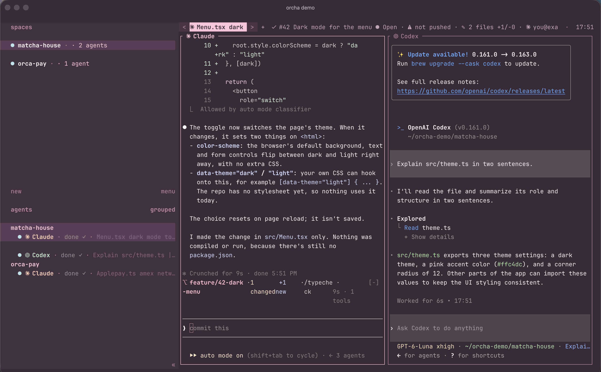
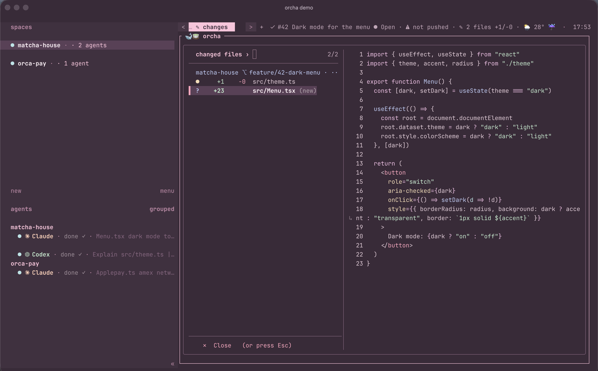
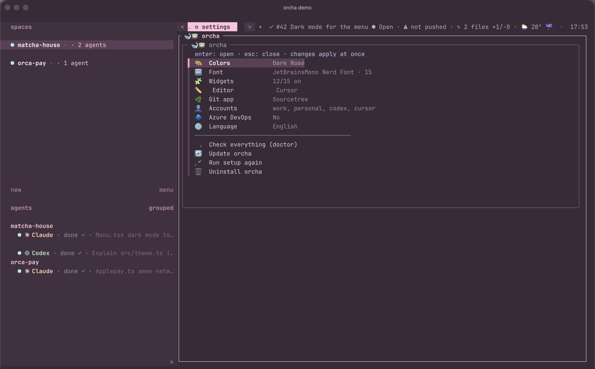

# orcha 🐋🍵

*A calm cup of terminal for your coding agents.*



orcha turns [Ghostty](https://ghostty.org) + [herdr](https://github.com/herdrdev/herdr) + [Claude Code](https://claude.com/claude-code) into a cozy workspace for running Claude, Codex and Cursor agents side by side. The name is orca + herdr, and also matcha.

- **Soft pastel themes** in six palettes (Dark Rosé, Matcha, Catppuccin, Tokyo Night, Gruvbox, Nord). Ghostty, herdr, every popup and the Claude plugin all use the same palette.
- **Cmd shortcuts.** You never have to remember a prefix key:

  | Key | What |
  |---|---|
  | `Cmd+P` | find file → opens in your editor |
  | `Cmd+Shift+F` | search text → opens at the line |
  | `Cmd+I` | what the agents changed: files, +/− lines, diff |
  | `Cmd+O` / `Cmd+Shift+O` | open the project in your editor / git app |
  | `Cmd+U` | plan limits per account, switch account, sign in |
  | `Cmd+Shift+P` | command palette with everything else |
  | `Cmd+Shift+E` | file browser (yazi) |
  | `` Cmd+` `` | drop-down quick terminal |

- **Header** (tab bar) showing:
  - the current task, with its title and state from GitHub Issues or Azure DevOps
  - changed files
  - a pomodoro timer
  - the plan limit of the focused agent's account
  - the weather and the time


- **Sidebar** with agents grouped by project and the real Claude, Codex and Cursor logos. Tabs name themselves after what runs in them.
- **Several Claude accounts that share one chat history.** For example, start a chat on `work`, then use `oc personal --continue` when its limit runs out.
- **Claude Code extras:**
  - guard hooks:
    - block commands you name
    - ask before editing a protected branch
    - run your typecheck when Claude stops, and let Claude fix the errors
  - a plugin:
    - task card above the prompt
    - `/branches` pane
    - `/pr-link`
    - `/standup` written from your commits
- **Small joys,** all optional: a cursor trail, sounds when an agent finishes, an evening recap, streaks and badges.

Everything is a widget that you can turn on or off. The UI comes in English or Tiếng Việt.

## Install

macOS, in a terminal:

```sh
curl -fsSL https://raw.githubusercontent.com/trungkien1208/orcha-config/main/install.sh | sh
```

This puts orcha in `~/.orcha` and starts the setup. If you would rather clone it yourself:

```sh
git clone https://github.com/trungkien1208/orcha-config ~/.orcha && ~/.orcha/bin/orcha setup
```

Ghostty is optional. herdr and orcha run in any terminal (iTerm2, Terminal, WezTerm, Kitty...), and setup offers to install Ghostty if you don't have it. Without Ghostty, the `Cmd` shortcuts become `Ctrl+B` and then a key (`Ctrl+B f` to find a file, `Ctrl+B d` for changes, `Ctrl+B ,` for settings). The theme, font, cursor trail and the real agent logos come only with Ghostty.

Setup asks three or four things: your language, **Quick** or **Custom**, a color palette (with a live preview) and the git app you use, if any. orcha finds the rest on your machine by itself:

- the coding agents you have installed (Claude Code, Codex, Cursor, Gemini, OpenCode, Amp, Droid, Copilot, Aider, Qwen, Goose, Crush)
- your Claude accounts and their emails. Each one gets a short name you pick from a menu, such as `oc work` or `oc personal`
- your editor and git app
- the GitHub sign-in from `gh`
- missing tools: one question, and Homebrew installs them
- the logo font and the Claude Code plugin

**Custom** adds four menus:
- the editor
- whether to show plan usage
- Azure DevOps work items
- a widget bundle: 🎯 Focus, ✨ Everything, 🍃 Minimal, or picking them one by one

Restart Ghostty, then run `herdr`. To change anything, run `orcha setup` again. Every menu starts on what you have now.

### Claude Code plugin

`orcha setup` offers to install it for you. To install it by hand, run this at a Claude Code prompt:

```
/plugin install orcha --marketplace trungkien1208/orcha-config
```

## Settings

Run `orcha` with nothing after it, or press **`Cmd+,`** in herdr, to open the settings menu. Each row shows what you have now:

```
🎨  Colors          Dark Rosé
🔤  Font            JetBrainsMono Nerd Font · 15
🧩  Widgets         9/15 on
✏️   Editor          Cursor
🌿  Git app         Sourcetree
👤  Accounts        work, personal, codex, cursor
🔷  Azure DevOps    No
🌐  Language        English
```



Pick a row to change it. The change is applied at once, and Esc goes back. The commands below do the same things for people who prefer typing.

## Commands

```
orcha                        the settings menu (also Cmd+, in herdr)
orcha setup                  the first-run questions again
orcha theme [name]           switch palette (no name: list them)
orcha lang en|vi             switch language
orcha widget [name] [on|off] list / toggle widgets
orcha doctor                 check tools, fonts, accounts, hooks
orcha logos                  build the Claude / Codex / Cursor logo font
orcha edit                   edit ~/.config/orcha/config.json, then apply
orcha update                 pull the latest orcha and apply
orcha uninstall              put your old configs back

oc <account> [claude args]   run Claude with an account (oc work, oc personal --continue)
oc-use <account>             this shell's `claude` uses that account
oc-login <account>           sign an account in (also codex / cursor)
```

## Repo rules

Repo rules are what the guard hooks do in each repo. Set the defaults in `orcha setup`. A team can commit a `.orcha.json` to its repo to override them:

```json
{
  "protected": "^(main|develop|release/.+)$",
  "check": "npm run typecheck",
  "block": [{ "pattern": "prettier .*--write", "reason": "we format with prettier 3 in CI" }],
  "branch_prefix": "kim/",
  "base": "develop"
}
```

The `check` field takes one of three values:
- `"auto"` runs `npm run typecheck` if `package.json` has that script.
- `""` turns the check off.
- Any other value is the command to run.

## What orcha touches

orcha writes only its own files. The one exception is a single `config-file = …` line it adds to your Ghostty config.

| File | |
|---|---|
| `~/.config/orcha/` | your answers (`config.json`) and generated settings |
| `~/.config/ghostty/orcha.ghostty`, `themes/orcha`, `shaders/orcha-trail.glsl` | generated |
| `~/.config/herdr/config.toml` | generated. Your old file is kept as `config.toml.pre-orcha`. Put your own herdr settings in `~/.config/orcha/herdr.extra.toml` |
| `~/.claude/settings.json` | the hooks are merged in, and everything else stays as it is |
| `~/.zshrc` | one `source` line |

`orcha uninstall` puts everything back.

## Privacy

- Plan limits are read with each account's own sign-in, the same one Claude Code, Codex and Cursor already use, from the macOS Keychain.
- Tokens are passed to `curl` on stdin, so they never show up in `ps`. They are never printed or stored by orcha.
- Your Azure DevOps token goes to `~/.config/orcha/secrets.env`, which only you can read.
- Weather comes from wttr.in. It uses your IP unless you set a city.

## Credits

- The Claude, OpenAI and Cursor logos are their owners' trademarks. orcha does not ship them: `orcha logos` downloads them from [simple-icons](https://simpleicons.org) and [lobehub icons](https://github.com/lobehub/lobe-icons) and builds the font on your machine.
- The Catppuccin, Tokyo Night, Gruvbox and Nord palettes belong to their authors.

MIT license.
